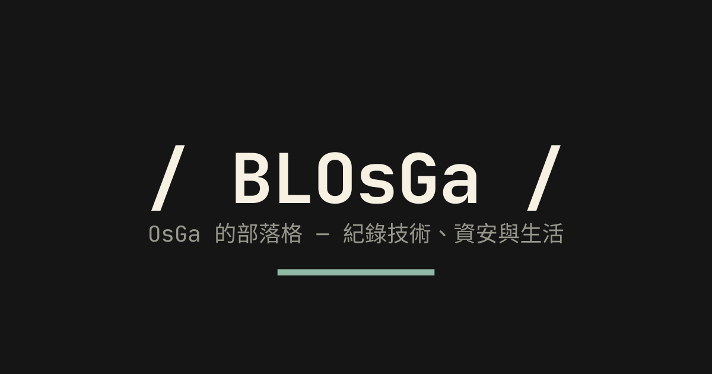

# BLOsGa

> OsGa 的個人部落格 — https://blog.osga.dev

與個人網站 [osga.dev](https://osga.dev) 共用同一套設計語言：米白／墨黑／灰綠配色、JetBrains Mono、直角邊框與細分隔線。



## 技術

- Astro 6 · 純 CSS（無 Tailwind）· `astro-icon`（lucide / simple-icons）
- Pagefind 站內搜尋（⌘K / `/` 隨處開啟）、RSS、Sitemap
- Shiki 雙主題程式碼高亮、閱讀時間、目錄 scroll-spy、程式碼複製、圖片燈箱

## 開發

```bash
pnpm install
pnpm dev      # http://localhost:4321
pnpm build    # astro check + build + pagefind（搜尋需先 build）
```

## 寫文章

在 `src/content/posts/<slug>/index.md` 新增文章，圖片放同一個資料夾：

```yaml
---
title: 文章標題
pubDate: 2026-10-14
description: 一句話摘要
heroImage: hero.png
tags: [tag1, tag2]
category: Life
draft: false
---
```

提示框：`<div class="info|note|tip|success|warning|danger">…</div>`，樣式在 `src/styles/prose.css`。

## 結構

```
src/
├── components/   HomeHeader、PostGrid、AboutCard、Sidebar、Search、TableOfContents…
├── layouts/      BaseLayout（首頁卡片網格 / 內頁側欄）
├── pages/        /、/posts/[slug]/、/tags/、/category/、/search/
├── styles/       global.css（設計 token）、prose.css（文章排版）
└── consts.ts     站名、導覽、社群連結
```
