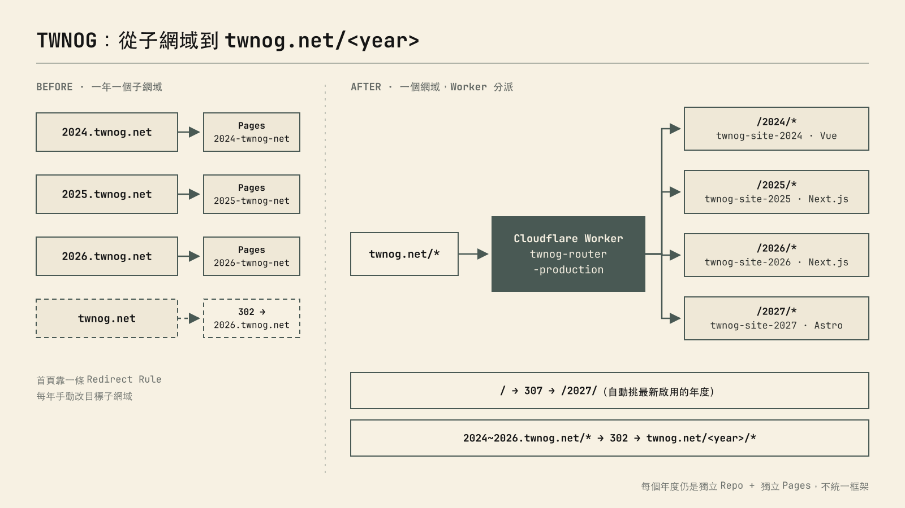
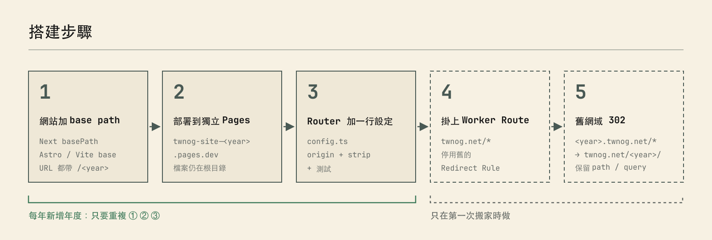
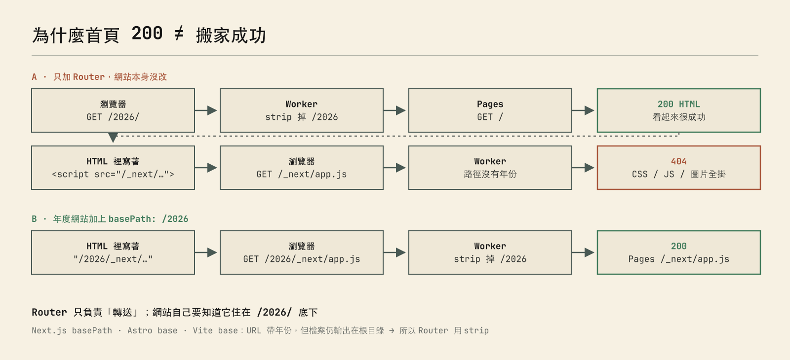
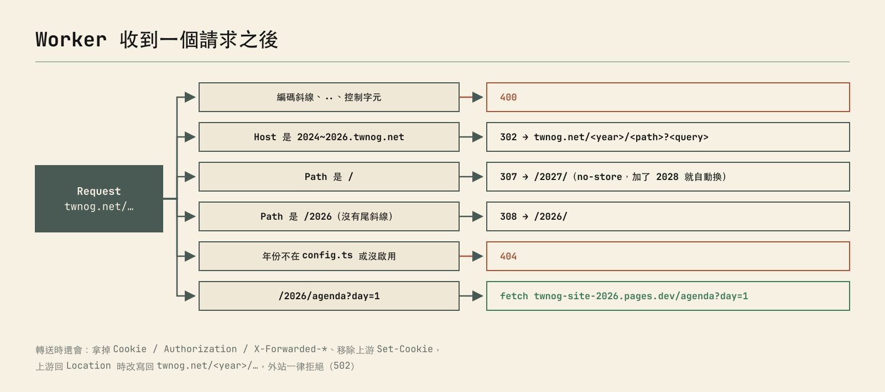

# 前言

去年在 TWNOG 7.0 加入 infra 組之後，今年有幸接手製作 2027 年 TWNOG 8.0 的網站

不過在開始寫新網站之前，有一些累積下來的技術債和需求想先處理掉，其中一個就是歷年網站的網址

如果你有使用過 GitHub Pages 或看過 SITCON 網站的話，你應該會發現你可以用不同 path 到歷年不同技術棧的年會網站或其他資訊網站，像是：

- [sitcon.org/2013](https://sitcon.org/2013/) 是純 HTML
- [sitcon.org/2022](https://sitcon.org/2022/) 是 Vue 3 + Vite
- [sitcon.org/2025](https://sitcon.org/2025/) 是 Next.js
- [sitcon.org/2026](https://sitcon.org/2026/) 換成了 Astro
- [sitcon.org/podcast](https://sitcon.org/podcast/) 則是一頁 HTML + JS 的 Podcast 頁面

每個網站都是 [sitcon-tw](https://github.com/sitcon-tw) 底下各自獨立的 Repo，各年的人用自己熟悉的框架，互相不會影響

這其實是 GitHub Pages 本身的機制：組織的主站 Repo（`sitcon-tw.github.com`）綁了自訂網域 `sitcon.org` 之後，同一個組織底下其他有開 Pages 的 Repo，就會自動出現在 `sitcon.org/<repo 名稱>/`，所以 Repo 叫 `2026`，網址就是 `sitcon.org/2026/`

```text
sitcon-tw/sitcon-tw.github.com  →  sitcon.org/
sitcon-tw/2026                  →  sitcon.org/2026/
sitcon-tw/podcast               →  sitcon.org/podcast/
```

不過 Cloudflare Pages 就沒有這種「同一個網域底下，依路徑分給不同專案」的功能了，一個 Custom Domain 只能綁一個 Pages 專案，所以想在 Cloudflare 上做到一樣的效果，就得自己動手

而 TWNOG 的狀況跟 SITCON 很像，每年都會有一個新網站，而且每年的人、技術棧都不太一樣

2024 是 Vue，2025、2026 是 Next.js，2027 換成 Astro，每一屆都是獨立的 GitHub Repo、獨立的 Cloudflare Pages，網址也是一年一個子網域：

```text
https://2024.twnog.net/
https://2025.twnog.net/
https://2026.twnog.net/
```

主網域 `twnog.net` 則是靠一條 Redirect Rule 302 到當年的子網域，每年換屆就要記得去 Dashboard 改一次

用久了還是覺得有點亂，所以想統一成 `twnog.net/2025/` 這種路徑形式。但又不想把四個網站合成一個大 Monorepo，畢竟每年的人都不一樣，硬要統一框架只會讓明年的人更痛苦

所以目標大概是這樣：

- 對外只有一個網域 `twnog.net/<year>/`
- 每個年度**保留自己的 Repo、自己的 Pages、自己的框架**
- 首頁自動導向最新一屆，不用每年改規則
- 舊的子網域連結不能壞
- 明年加 2028 的時候，越少步驟越好

# 架構



_左邊是原本的樣子，右邊是現在的樣子_

核心概念很單純，在 `twnog.net/*` 前面掛一個 Cloudflare Worker 當中央 Router，看路徑的第一段是哪一年，就把請求轉給那一年的 Pages：

| 公開路徑  | 實際來源                    | 框架    |
| --------- | --------------------------- | ------- |
| `/2024/*` | `twnog-site-2024.pages.dev` | Vue     |
| `/2025/*` | `twnog-site-2025.pages.dev` | Next.js |
| `/2026/*` | `twnog-site-2026.pages.dev` | Next.js |
| `/2027/*` | `twnog-site-2027.pages.dev` | Astro   |

使用者打開 `twnog.net/2026/agenda`，Worker 會去跟 2026 的 Pages 要 `/agenda`，再把內容原封不動丟回去，瀏覽器的網址列一直都是 `twnog.net/2026/agenda`

另外兩個附加功能也都在同一個 Worker 裡：

- 首頁 `/` 會 307 到**最新啟用的年度**，目前是 `/2027/`，加了 2028 就會自己換過去
- 舊的 `2024~2026.twnog.net` 全部 302 到 `twnog.net/<year>/`，路徑跟 Query String 都會保留

> 為什麼不用 Pages 的 Custom Domain 或 Redirect Rules 就好？Custom Domain 只能整個網域綁一個 Pages 專案，沒辦法依路徑分給不同專案；Redirect Rules 只能轉址，網址列會變。要「同一個網域、不同路徑、不同來源」，就需要一層 Reverse Proxy，Worker 剛好最順手

# 搭建步驟



整個搬家分成五步，其中第 4、5 步只有第一次要做，之後每年加新年度只要重複前三步

## 1. 讓網站知道自己住在 /2026/ 底下

這步最容易被忽略，但其實最重要。Router 只負責轉送，**網站自己產生的連結**必須帶上年份，不然一定會出事

四個框架各自的設定：

```ts
// 2025、2026：next.config.ts
const nextConfig: NextConfig = {
  output: "export",
  basePath: "/2026",
  images: { unoptimized: true },
};
```

```js
// 2027：astro.config.mjs
export default defineConfig({ base: "/2027" });
```

```js
// 2024：vite.config.js
export default defineConfig({ base: "/2024/" });

// src/router/index.js，Vue Router 跟著 BASE_URL 走
createRouter({ history: createWebHistory(import.meta.env.BASE_URL), ... });
```

只改設定檔還不夠，要注意這些**寫死的根路徑**：

- `` 這種直接寫死的圖片，Next.js 的 `basePath` 不會幫你補
- 下載連結、PDF
- `sitemap.ts`、OG 圖片的絕對網址
- i18n 翻譯檔裡面的連結

Next.js 的 `<Link>` 和 `router.push` 會自動加 basePath，但一般的 `<a>`、`` 和字串拼出來的路徑都要自己處理，2025、2026 光這部分就各改了十幾個檔案

### 為什麼首頁 200 不代表成功



如果只掛 Router、網站沒改，打開 `/2026/` 首頁會正常回 200，看起來好像成功了

但 HTML 裡寫的是 `/_next/static/...`，瀏覽器就會去要 `twnog.net/_next/...`，這個路徑沒有年份，Router 不知道要轉給誰，結果就是 CSS、JS、圖片全部 404，畫面一片白

所以驗收的時候不能只看首頁狀態碼，要把 HTML 裡實際引用的資源都打一遍

## 2. 部署到獨立的 Pages

每個年度 build 完直接用 Wrangler 丟到自己的 Pages 專案：

```sh
# Next.js（output: export）
npm run build
npx wrangler pages deploy out --project-name twnog-site-2026 --branch main

# Astro / Vite
npx wrangler pages deploy dist --project-name twnog-site-2027 --branch main
```

這邊有個重點：**`basePath` 只會改 URL，不會改輸出的資料夾結構**

也就是說 `basePath: "/2026"` build 出來的 `out/` 裡面，檔案還是在根目錄，不會多一層 `2026/`。HTML 裡寫 `/2026/_next/app.js`，但 Pages 上實際的檔案是 `/_next/app.js`

所以下一步 Router 轉送的時候要把年份**拿掉**再轉，這個我叫它 `strip` 模式

> 命名的部分我統一用 `twnog-site-<year>`，原本的 `2025-twnog-net` 那些專案在確認新網址穩定後就刪掉了，舊子網域改由 Worker 負責 302

## 3. Router 設定

Router 是一個獨立的 Repo，年度對應全部集中在 `src/config.ts`：

```ts
// twnog-router/src/config.ts
export const sites = Object.freeze({
  "2024": {
    origin: "https://twnog-site-2024.pages.dev",
    rewrite: "strip",
    enabled: true,
  },
  "2025": {
    origin: "https://twnog-site-2025.pages.dev",
    rewrite: "strip",
    enabled: true,
  },
  "2026": {
    origin: "https://twnog-site-2026.pages.dev",
    rewrite: "strip",
    enabled: true,
  },
  "2027": {
    origin: "https://twnog-site-2027.pages.dev",
    rewrite: "strip",
    enabled: true,
  },
});

// 舊子網域，只認白名單
export const legacyHosts = Object.freeze({
  "2024.twnog.net": "2024",
  "2025.twnog.net": "2025",
  "2026.twnog.net": "2026",
});
```

`rewrite` 有兩種模式：

| 模式       | 公開 URL             | 轉給 Pages 的 URL    |
| ---------- | -------------------- | -------------------- |
| `strip`    | `/2026/agenda?day=1` | `/agenda?day=1`      |
| `preserve` | `/2026/agenda?day=1` | `/2026/agenda?day=1` |

就像上一步講的，四個框架 build 出來檔案都在根目錄，所以全部用 `strip`。如果哪天有網站真的把檔案輸出在 `/2026/` 資料夾底下，才改用 `preserve`

轉送的核心其實就幾行：

```ts
const match = /^\/(\d{4})(?:\/|$)/.exec(url.pathname);
const year = match?.[1];
if (!year || !sites[year]?.enabled) return errorResponse(404);

const upstream = new URL(sites[year].origin);
upstream.pathname = url.pathname.slice(year.length + 1); // strip 掉 /2026
upstream.search = url.search;

return fetch(
  new Request(upstream, {
    method: request.method,
    headers,
    redirect: "manual",
  }),
);
```

首頁要導向最新年度的話，就是把設定裡啟用的年份排序取最後一個：

```ts
if (url.pathname === "/") {
  const latest = Object.keys(sites)
    .filter((y) => sites[y].enabled)
    .sort()
    .at(-1);
  return Response.redirect(`https://twnog.net/${latest}/`, 307);
}
```

這邊刻意用 **307 暫時轉址**再加上 `Cache-Control: no-store`，如果用 301，瀏覽器會把「`/` → `/2027/`」快取起來，明年換成 2028 的時候舊訪客還會一直被導到 2027

## 4. 掛上 Worker Route

`wrangler.jsonc` 裡把 Worker 掛到整個主網域，並關掉 `workers.dev` 的備用網址：

```jsonc
{
  "name": "twnog-router-production",
  "main": "src/index.ts",
  "workers_dev": false,
  "preview_urls": false,
  "vars": {
    "PUBLIC_HOST": "twnog.net",
    "ROOT_REDIRECT": "latest",
  },
  "routes": [
    { "pattern": "twnog.net/*", "zone_name": "twnog.net" },
    { "pattern": "2024.twnog.net", "custom_domain": true },
    { "pattern": "2025.twnog.net", "custom_domain": true },
    { "pattern": "2026.twnog.net", "custom_domain": true },
  ],
}
```

```sh
npx wrangler deploy --env production
```

這邊踩到一個坑：**Redirect Rules 比 Worker 更早執行**

原本那條「`twnog.net` → 302 → `2026.twnog.net`」的規則還開著的話，請求根本進不到 Worker，掛了 Route 也沒用。所以要去 Dashboard 的 Rules 把舊規則**停用**（先不要刪，要回復的時候重新打開就好）

> 建議正式切換前先找一個沒在用的子網域，例如 `migration.twnog.net`，掛同一支 Worker 測過一輪，確認沒問題再動主網域

## 5. 舊網域轉址

舊的子網域也是掛在同一支 Worker 上，用 Host 白名單判斷：

```ts
if (Object.hasOwn(legacyHosts, url.hostname)) {
  const year = legacyHosts[url.hostname];
  const target = new URL(`https://twnog.net/${year}${url.pathname}`);
  target.search = url.search;
  return new Response(null, {
    status: 302,
    headers: { Location: target.href },
  });
}
```

```text
2025.twnog.net/agenda?day=1  →  302  →  twnog.net/2025/agenda?day=1
```

舊子網域我是設成 Worker 的 **Custom Domain** 而不是 Route，部署時 Cloudflare 會自動建好 Proxied 的 DNS 紀錄，舊的 Pages 專案刪掉也不影響。如果用 Route，就得自己保留一筆 Proxied 的 DNS 紀錄，請求才進得到 Worker

這邊一樣先用 302，等穩定一陣子再考慮換 301，301 被快取之後就很難反悔了

# Worker 裡面的判斷流程

整個 Router 主程式大概 110 行，收到請求之後依序判斷：



因為這本質上是一個 Reverse Proxy，所以多做了一些安全上的處理：

- **上游寫死**：只接受 `config.ts` 裡的 `*.pages.dev`，不會從使用者輸入組出上游網址
- **路徑檢查**：擋掉 `%2F` 編碼斜線、`..`、控制字元，避免用奇怪的路徑跨年度存取
- **不轉送憑證**：轉送前拿掉 `Cookie`、`Authorization`、`X-Forwarded-*`，回應時移除上游的 `Set-Cookie`，反正都是靜態網站用不到，也避免不同年度之間共用到 Cookie
- **改寫 Location**：上游如果回 redirect，`Location` 會改寫回 `twnog.net/<year>/...`；指到外站的一律回 502
- **`redirect: "manual"`**：不讓 Worker 自己跟著上游的轉址跑去別的地方

對一個研討會網站來說可能有點過度設計，但多擋一點總是比較安心

# 明年要加 2028 怎麼辦

這也是當初選這個架構最主要的原因，流程只剩：

1. 2028 的網站設定 `base: "/2028"`，寫死的路徑記得補
2. `wrangler pages deploy` 到 `twnog-site-2028`
3. `config.ts` 加一行，跑測試，`wrangler deploy`

首頁會自動導到 `/2028/`，DNS、Redirect Rules 都不用動。舊年度要下架的話，把 `enabled` 改成 `false` 就好

# 還沒做完的

目前這些 `twnog-site-<year>` 都是 **Direct Upload** 部署，沒有接 GitHub，也就是 push 到年度 Repo 不會自動更新 `twnog.net/<year>/`

之後要在各年度的 GitHub Actions 加上部署步驟，配一把權限最小的 API Token：

```text
TWNOG/2027 push → GitHub Actions build → wrangler pages deploy → twnog-site-2027
```

Router 本身的 CI 目前只有跑型別檢查和測試，不會自動部署，這部分之後再補

# 關於 Codex

這次的規劃跟實作有用 Codex 來協助，像是盤點 Cloudflare 上的資源、四個專案的 base path 修改、Router 跟測試的撰寫，還有切換後的資源驗證

而且有很多需要重複性做的事情，像是更改 `baseURL` 等等，可以委派 codex 協助

不過權限相關的部分還是得自己來，像是停用舊的 Redirect Rule、確認 DNS，以及 `git push`，這些 agent 手上的 Token 沒有權限，也本來就不該給他

另外比較有感的一點是驗收，首頁回 200 很容易讓人以為完成了，實際上要把頁面裡引用的 CSS、JS、圖片、子頁都打過一輪才算數，這部分交給 agent 跑一整串檢查還蠻省事的

<div class="info">至於你問我為什麼選擇 codex? 因為快到期了要先好好利用一波(X </div>

# 結語

整體來說，多個不同框架的網站，在不合併 Repo 的前提下塞進同一個網域，加一個年度只要改一行設定，這個結果還蠻滿意的

加上我自己也是 Cloudflare pages 派，這套 router 邏輯也便於我套用在其他服務上，也希望可以幫助其他有相同需求的人！

> Router 原始碼：未來會整理到我的 GitHub 上，有需要可以來找我交流 `(=ↀωↀ=)✧`
