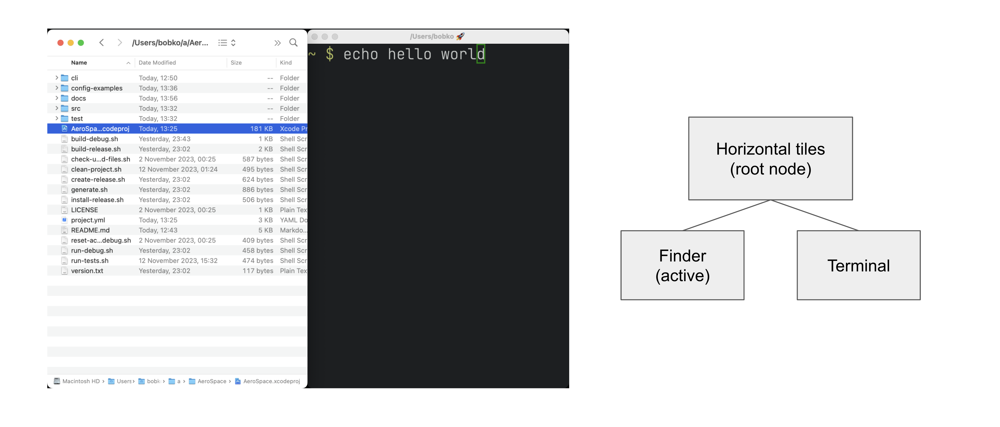
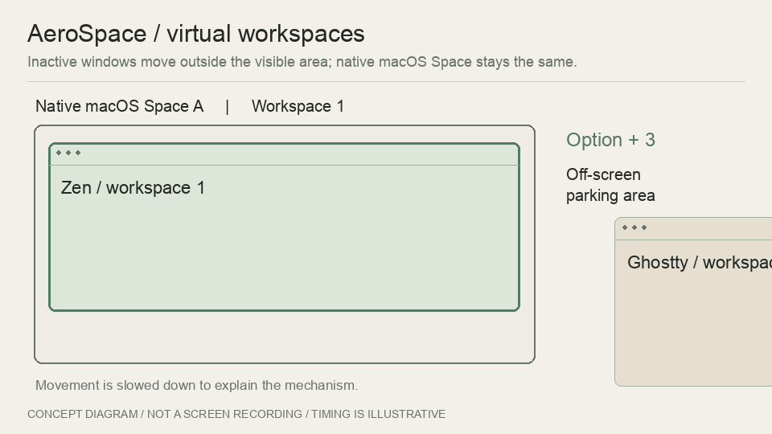
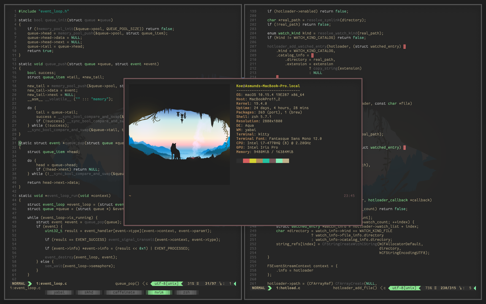
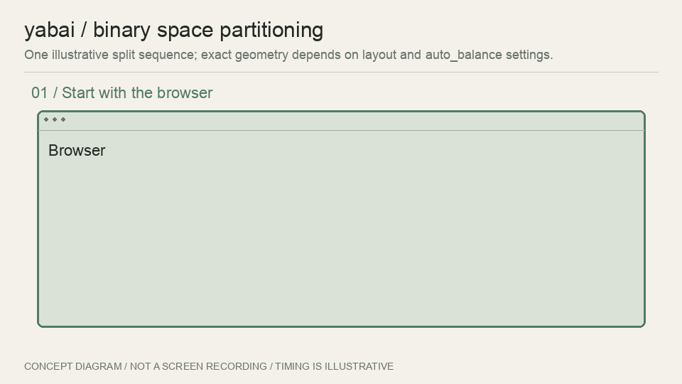
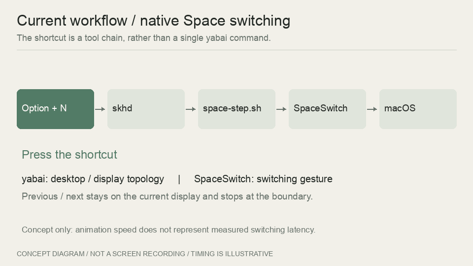

<!-- 編輯註記：RDP 全螢幕的具體問題仍待補充；目前架構依本機設定與「yabai 設定」紀錄整理。 -->

# 前言

之前在 [My MacOS Setup](/posts/my_macos_setup/) 有介紹過 yabai，可以把視窗自動排好，搭配 skhd 用快捷鍵操作，再加上 JankyBorders 看現在到底選到哪個視窗

不過中間我其實跑去用了 AeroSpace，兩套各用了一年多，然後這幾天又回到 yabai 的懷抱

最諷刺的是，我本來正準備寫一篇 AeroSpace 的使用體驗與教學，結果那篇還沒生出來，我就先換回去了ㄏㄏ

所以這篇就順便記錄一下，當初為什麼換過去、後來為什麼又搬回來，還有現在這坨設定到底是怎麼串起來的

# 為什麼跑去用 AeroSpace

我平常是兩個螢幕一起用，基本上就是瀏覽器、終端機、音樂，再加上一些通訊或開發工具

視窗多了之後，除了不想一直拿滑鼠拉來拉去，我也希望切桌面可以快一點。原本那套 yabai 設定，在保持 SIP 開啟的情況下，切換 Space 的速度就是沒有我想要的感覺

這邊先講一下，**把視窗排好**跟**切換桌面**是兩件事。像是把瀏覽器和終端機左右各放一半，是平鋪；從桌面 1 跑到桌面 2，才是切換 Space

當然 yabai 也沒有一定要關 SIP 才能用，像平鋪本身就可以正常運作，只是部分功能需要 scripting addition，才會牽涉到部分停用 SIP。詳細哪些功能有需要，可以看[官方說明](https://github.com/asmvik/yabai/wiki/Disabling-System-Integrity-Protection)

而 AeroSpace 剛好可以不用關 SIP，就有快速、沒有動畫的工作區切換，對當時的我來說十分香，於是就搬過去了

> 專案連結：<https://github.com/nikitabobko/AeroSpace>

# 用肌肉記憶切軟體

換過去之後，我把每個軟體都分配到固定的 Workspace，也就是 AeroSpace 裡的工作區

像是 Zen 放在 1、Discord 和 Telegram 放在 2、Ghostty 放在 3，音樂就丟到 9

用久了其實很方便，想看網頁就按 `Option + 1`，要用終端機就按 `Option + 3`，不用想他現在到底在哪個桌面，手自己就會去按了

```toml
[mode.main.binding]
alt-1 = 'workspace 1'
alt-2 = 'workspace 2'
alt-3 = 'workspace 3'

# 以下為當時設定的部分節錄
[[on-window-detected]]
if.app-id = 'app.zen-browser.zen'
run = ['layout tiling', 'move-node-to-workspace 1']

[[on-window-detected]]
if.app-id = 'com.mitchellh.ghostty'
run = ['layout tiling', 'move-node-to-workspace 3']
```

兩個螢幕也有分配好，1、3、5、7 放主螢幕，2、4、6、8、9 優先放副螢幕，沒接副螢幕就回到主螢幕

基本上設定完之後，軟體打開就會自己去該去的地方，我只要負責按快捷鍵過去就好。這也是我用 AeroSpace 用了這麼久，覺得很舒服的地方



_借用官方的水平 tiles 示意，左邊是視窗，右邊是對應的容器樹。[圖片來源](https://github.com/nikitabobko/AeroSpace/blob/c960a8ac9c54a0ab61f145a0ef1d9b09832ca9d5/docs/assets/h_tiles.png) · © 2023 Nikita Bobko · [MIT 授權全文](/media/window-workflow/AeroSpace-LICENSE.txt)。_

## 不過，他的 Space 跟 Mac 的不太一樣

AeroSpace 有自己的 Workspace，切換時會把其他工作區的視窗搬到螢幕外的左下或右下角，要用的時候再搬回來，所以你看到的是另一批視窗出現在畫面上

簡單講，其他視窗只是先被藏到旁邊，並沒有全部縮到 Dock，macOS 原生的 Space 也沒有跟著切換。覺得這個做法很有趣的可以看[官方的原理解釋](https://nikitabobko.github.io/AeroSpace/guide#emulation-of-virtual-workspaces)



_這張是自己做的原理示意，故意把移動放慢，方便看視窗跑去哪裡，實際切換不會等這麼久。原理來源：[AeroSpace 官方指南](https://nikitabobko.github.io/AeroSpace/guide#emulation-of-virtual-workspaces)。_

不過事情碰到 macOS 原生全螢幕就開始有點麻煩，因為原生全螢幕會另外開一個 Space，於是就變成 AeroSpace 管自己的 Workspace，macOS 又有自己的 Space，兩套要一起顧

而我自己就很喜歡把 RDP 放全螢幕使用，所以這部分也是後來重新考慮原生 Spaces 的原因之一

另一方面不能用四指來切換 Space RRR，要換的話就一定要按 hotkey，雖然講求 hotkey 至上，但有時就是想滑來滑來切換哈哈

> 這部分也有人製作相關的工具可以改用三指切換，不過就沒辦法移動視窗了，都必須做點取捨

> 關於多螢幕和原生全螢幕的關係，可以參考 [AeroSpace 官方說明](https://nikitabobko.github.io/AeroSpace/guide#a-note-on-displays-have-separate-spaces)

<!-- 待補本人實際經驗：RDP 是否使用原生全螢幕、當時如何切換、預期結果與實際問題，以及這是否為決定換回的主因。此處暫不推測黑屏、焦點或快捷鍵失效等症狀。 -->

# 然後我又把 yabai 裝回來了

這幾天換回來後，我發現自己用的方法也跟之前不太一樣

之前會很在意瀏覽器一定要在 1、終端機一定要在 3，現在就比較懶得管這些，我需要一起看網頁和終端機，就讓他們在同一個桌面排好就好

所以我把原本那些「這個 App 要去哪個桌面」的規則全部註解掉，讓 yabai 幫我處理眼前這些視窗的排列，需要其他桌面再切過去

快速切換還是要有，快捷鍵也還是照用，只是沒有再那麼糾結每個軟體一定要住在哪裡。用起來反而比較單純一點

# 現在這坨設定到底有什麼

講了那麼多，來看一下現在到底裝了什麼

這次一樣保持 SIP 開啟，也沒有載入 scripting addition，不過要把原本的操作習慣接回來，光裝 yabai 還不夠，所以旁邊又多了幾個小工具

| 元件          | 在目前配置中的工作                                        |
| ------------- | --------------------------------------------------------- |
| skhd          | 接收快捷鍵，呼叫對應命令                                  |
| yabai         | BSP 平鋪、視窗焦點、交換位置，以及提供桌面與顯示器資訊    |
| SpaceSwitch   | 以合成切換手勢處理原生 Space 的快速切換                   |
| space-step.sh | 找出目前螢幕的上一個或下一個桌面，再交給 SpaceSwitch      |
| wm-compat     | 處理縮放、浮動切換、BSP／Stack 切換與跨螢幕移窗的輔助邏輯 |

如果只看名字有點亂，實際上按下快捷鍵之後，大概是這樣跑：

```text
鍵盤 → skhd
        ├─ 方向焦點、交換位置 → yabai → 視窗排列
        ├─ 縮放、浮動等操作 → wm-compat → yabai
        ├─ 數字切桌面 → SpaceSwitch → 查詢 yabai → macOS 切換手勢
        └─ 上／下一個桌面 → space-step.sh → SpaceSwitch

yabai 的桌面／顯示器事件 → SketchyBar → 更新狀態顯示
```

## 平鋪交給 yabai



_這張是官方 repo 裡的桌面範例，我自己的設定跟他不一樣，先借來看一下效果。[圖片來源](https://github.com/asmvik/yabai/blob/dd845723416f5fe92af49fad5ebab00369e07edd/assets/screenshot.png) · © 2019 Åsmund Vikane · [MIT 授權全文](/media/window-workflow/yabai-LICENSE.txt)。_

目前主要用 BSP，也就是把一塊區域切成兩塊，再繼續分給其他視窗。像原本只有一個瀏覽器，開了終端機就切一塊給他，再開新的視窗就繼續切

和 AeroSpace 那種受 i3 啟發的容器樹有點不一樣，有興趣可以看 [yabai 的介紹](https://github.com/asmvik/yabai)和 [AeroSpace 的佈局說明](https://nikitabobko.github.io/AeroSpace/guide#tree)

我的設定主要就這幾行：

```sh
yabai -m config layout bsp
yabai -m config split_type auto
yabai -m config split_ratio 0.5
yabai -m config auto_balance on
yabai -m config window_gap 6
```

讓他自己判斷要左右切還是上下切，預設先一人一半，視窗增加或減少時再自動平衡，間距留 6 點

不過 `auto_balance` 開著的話，自己手動調好的比例，可能會在開關視窗後被重新分配。我目前先開著，至少不用每次有新視窗就自己喬半天



_一樣是自己做的示意，讓大家看一下怎麼分割。實際切在哪邊、分多大，還是要看分割方向、插入位置和 auto_balance 的設定。_

## 那快速切桌面怎麼辦

最初使用不知道為什麼沒辦法直接將視窗移動到 Space，以及無動畫切換到其他 Space，現在搬回來就是因為 agent 的協助，把我以前搬家的幾個痛點協助解決掉了

所以目前按 `Option + 數字`，會先由 skhd 叫起 SpaceSwitch，查一下 yabai 提供的桌面資訊，再送出 macOS 的切換手勢

SpaceSwitch 是用 C／Objective-C 寫的小工具，沿用了 strafe 的手勢實作再做調整，目前不用另外開 strafe.app，也不需要讓 SpaceSwitch 一直常駐

我也有綁 `Option + P / N` 來切前後桌面，這邊會先經過 `space-step.sh`，找目前螢幕的上一個或下一個桌面，到底就停，不會突然跳去另一個螢幕



_這張是照目前設定做的流程示意，亮起來代表現在跑到哪一步，時間一樣是為了方便看，不是實測速度。設定和原始碼放在 [yabai-gaWM](https://github.com/osga24/yabai-gaWM)。_

所以這個快速切換其實是這幾個工具串起來的結果。SpaceSwitch 是朝無動畫切換去做，不過有用到非公開的事件欄位，macOS 版本跟輔助使用權限都會影響結果，要搬去自己的電腦用還是得試一下

喔對，雙螢幕還有一個地方要注意，yabai 的桌面編號是把所有螢幕一起算的全域 index，所以拔插螢幕、新增或重排桌面之後，編號可能會變，要重新確認一下

## 快捷鍵先不要改，我手已經習慣了

雖然工具換了，但手已經按了一年多，所以我把不少 AeroSpace 時期的快捷鍵留了下來，不然又要重新適應一次，十分麻煩

> 其實當初轉 AeroSpace 也是盡量將當時 yabai 的設定轉過去

| 操作                         | 目前快捷鍵                       |
| ---------------------------- | -------------------------------- |
| 切換方向焦點                 | `Option + H / J / K / L`         |
| 交換方向視窗                 | `Option + Shift + H / J / K / L` |
| 切換原生桌面                 | `Option + 1–9`                   |
| 目前螢幕的上一個／下一個桌面 | `Option + P / N`                 |
| 浮動／平鋪                   | `Option + Shift + E`             |
| 桌面內放大／還原             | `Option + Shift + M`             |
| 平衡視窗大小                 | `Option + Shift + B`             |
| BSP／Stack                   | `Option + Shift + C`             |

這裡要特別提一下，`Option + Shift + M` 用的是 yabai 的 `zoom-fullscreen`，只會在現在這個桌面把視窗放大，不會像 macOS 原生全螢幕一樣另外開一個 Space

還有 yabai 的 Stack 跟 AeroSpace 的 Accordion 也不太一樣，所以按鍵可以沿用，但不能直接期待每個操作都跟以前一模一樣，這部分還是要稍微適應一下

## 當然也沒有搬回來就沒事了

現在這套也還是有一些要處理的地方，像我目前用的 yabai 就是拿 v7.1.25 自己編譯的版本，針對 macOS 27 的版本判斷補了一下，讓他走原本已有的視窗事件處理，目的是改善關窗後還留一塊空位的問題

這是自己補的，Homebrew 更新或重裝就會蓋掉，之後更新也要記得留意

另外有些 App 的視窗能不能被正確辨識、焦點有沒有跟上，還是可能需要個別處理，設定紀錄裡也還有一些待實際確認的項目。所以這篇先分享目前的組合，後面用到什麼問題再繼續補

# 結語

繞了一圈之後，工具又換回來了，但用法倒是跟之前不太一樣

之前比較在意每個軟體要待在哪個桌面，靠肌肉記憶去找他們；現在就希望需要的視窗可以排好，讓我不用一直拿滑鼠喬位置，剩下的就先不要管那麼多了

目前就是 yabai 配上 skhd，再加幾個小工具，把原生 Space 和快速切換接回來。設定又是一大坨，不過先記錄下來，免得哪天換電腦又要重弄一次

> 我的設定與工具：<https://github.com/osga24/yabai-gaWM>

如果有更好用的設定，或有什麼想法，歡迎找我交流 ><
